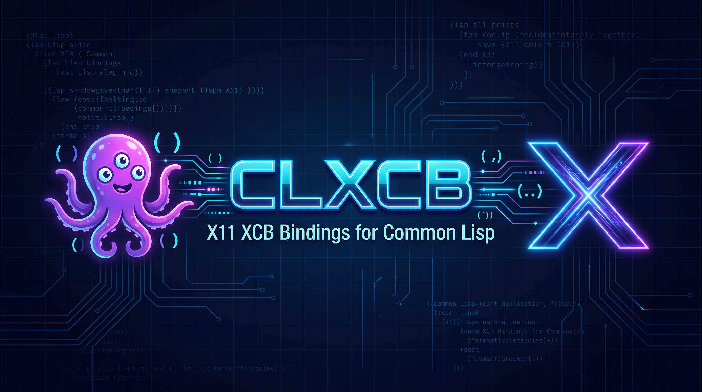

# CLXCB - XCB Specification for X11 protocol for Common Lisp

<p align="center">
  <a href="screenshots/clxcb.jpeg">
    
  </a><br/>
</p>

A pure Common Lisp client implementation of the X11 protocol, closely following
XCB specification and libxcb implementation.

CLXCB talks to the X server directly over its socket, with no C library in
between.  Protocol structures, requests, replies, events and errors are ordinary
Common Lisp classes and functions, generated from the same XML protocol
descriptions libxcb is generated from, so their names and arguments follow
libxcb one for one, and its documentation applies.  The connection layer around
them (connecting, flushing, reading replies and events) does what libxcb's does,
but of course adapted to Lisp.

---

## Features

**The whole protocol:** core X11 and 31 extensions (RENDER, SHAPE, XInput 2,
XKB, RandR, Present, DRI3, MIT-SHM, SYNC, GLX, ...).

**Thread-safe connections:** one connection can be used from several threads at
once, as with libxcb.

**Local and remote displays:** `$DISPLAY` is parsed as libxcb parses it;
Unix-domain sockets and TCP (for example `ssh -X`) both work, with Xauthority
cookies found through [clxau](https://github.com/amno1/clxau).

**Errors as conditions**, and checked requests (`request-check`,
`with-checked-requests`) for requests without a reply.

**File-descriptor passing** on Linux, for the requests that need it (DRI3,
MIT-SHM's fd requests, RandR leases).

**BIG-REQUESTS and XC-MISC** used automatically, so large requests and
long-running clients just work.

**A small set of helpers** for common chores: ICCCM and EWMH window properties,
RENDER picture formats, XInput 2 event masks and grabs, colors and geometry
strings, images.

**Portable and SBCL:** if you are using SBCL, you can save some space in the
image by using SBCL built-ins and extensions.  On other systems we use portable
replacements via CFFI, Bordeaux-threads, usocket, and other usual suspects.

---

## Why

What I wanted to achieve is a complete, 1:1 implementation of the XCB protocol
as specified in the [XML spec by
Xorg](https://gitlab.com/freedesktop-sdk/mirrors/freedesktop/xorg/proto/xcbproto).
The reason I want a 1:1 XCB implementation in Lisp is so I can refer to existing
libxcb programs, documentation etc.  If the XML specification ever changes, it
would also be easier to track and update the system.  Not that I think they will
ever update XCB, since Xorg seems to have switched completely to Wayland, but
still, I think it is good to have a clean separation.

A tiny layer of "lispy" utilities is of course provided.  Originally I had a
separate layer in its own namespace, but there were not so many, and it was
convenient to merge them all in the same xcb namespace.  Those have grown mostly
while I was porting some of the standard, well-known X11 programs and writing my
own demos.

Why do I want this: I need to implement a GUI backend for my little clone of GNU
Emacs in Common Lisp. I wish to have X11 and Wayland support. We already have a
Wayland protocol in Common Lisp implemented (via cl-wayflan), however, CLX is a
bit buggy, not in active development, and most importantly, it implements the
old Xlib interface, which is synchronous and slower than the async XCB
interface.

---

## Requirements

What you need is:

- ASDF (and GNU make) to build the library
- `uiop` for some portable constructs
- clxau for connection authorization (see below)

If you are happy with SBCL only, this is all you need.  For a portable version
you need additionally:

- CFFI for system calls
- Bordeaux-threads for threading and locking
- usocket for socket connections
- trivial-garbage for portable weak hash tables

No C compiler is needed.

For the authorization I use [clxau](https://github.com/amno1/clxau), which grew
up with and out of CLXCB.  I started using auth.lisp from CLX, but I ended up
refactoring it out in its own library and complementing with features it lacked.

When it comes to OS portability, currently this is a Linux-only implementation.
If you were to run it on some BSD or Apple kernel, I believe you would probably
have to hack it, but honestly I don't know.  If you do, see
[hacking](doc/hacking.md) for the more technical information on the library.

CLXCB is developed and tested on SBCL and Linux.  It should work on other Lisp
systems, as seen above, there are both portable and SBCL-only paths. I have
tested the portable path with CCL, but not as extensively as I have with
SBCL. If you do find bugs, unportable constructs, or inefficient constructs,
please let me know.

---

## Installation

None of this is in Quicklisp, so you will have to install it manually.

If you cloned to your drive, symlink the clones into Quicklisp's
`local-projects` directory, for example:

```bash
cd ~/quicklisp/local-projects
ln -s /path/to/cloned/clxcb
ln -s /path/to/cloned/clxau
```

Or clone it directly into `local-projects`. Then load it from the repl:

```lisp
(ql:quickload :clxcb)          ; portable
(ql:quickload :clxcb/sbcl)     ; or SBCL only
```

### Loading

Load the core protocol, then the extensions you need for your program with
`require`:

```lisp
(require :clxcb)            ; or :clxcb/sbcl
(require :clxcb/render)
(require :clxcb/xinput)     ; also loads XFIXES, which it imports
```
`clxcb` loads the core protocol. Each extension is loadable in its own
system too.  An extension that requires another extension lists it among
its ASDF dependencies, so you should be able to load one you need and not
think what that extension might need.  Dependencies are pulled out from
the XML specification for XCB.

If you are just testing and playing around in a throwaway slime session, you can
load all at once, inclusive key symbols:

```lisp
(ql:quickload :clxcb/all)   ; loads everything portable
```

When it comes to keysyms, X protocol does not define names for keys, such as
XK_q, XK_space and so on. Key symbols are part of Xlib, and defined in Xlib
headers, in keysymdef.h.  For convenience, I have also extracted all the key
symbols from keysymdef.h (via a codegen), but they are many, over 2300. Thus
they are in a namespace of their own and not loaded by default, to conserve
space. Typically if you just need a few, you can define them yourself, or if you
need just alphabet and digits you can even use plain Lisp character names like
#\a, #\2, #\Tab, etc.

If you want them explicitly but not load clxcb/all, you can require
`clxcb/keysyms`.  They are constants in the `XCB-CONST` package.

A note about keysyms I don't really know where else to put: Keysyms are exported
under their Xlib name.  In Xlib they are typically something like XK\_q, XK\_Q,
XK\_escape etc.  Since Common Lisp is by default case insensitive, all symbols
are uppercased at read time, I couldn't map both say XK\_q and XK\_Q to lisp
names cleanly.  I could have perhaps used something like +xk_q+ and +xk-q+ for
lower and upper, but that looked to me like an ugly and error-prone solution.
Instead, I am using the Unicode standard way to suffix lower-letter symbols with
'-small' and uppercased with '-capital'.  It is verbose, I know, but at least it
is coherent with what they already use for some symbols.  So unfortunately, if
you wish to use predefined key names you will have to type: +xk-q-small+ and
+xk-q-capital+.  If you just need a few simple keys in your app, you are good
with Lisp characters like #\q and #\Q too.

### Package names in the library

Core X11 lives in `XCB`; each extension is in a package of its own,
`XCB-<EXTENSION>` (`XCB-RENDER`, `XCB-INPUT`, ...), with its constants in
`XCB-CONST`.  Because every protocol field has an accessor of the same name,
these packages export many common words - `format`, `length`, `type`, `time`,
`sequence`, etc, and several extensions export the same ones.  In other words,
those names clash both with some Common Lisp symbols, and with each other, so
you can't `:use` `XCB` in your packages.

The only package safe to `:use` is `XCB-CONST`, by design. The others are best
referred to with a package prefix, or brought in with `:import-from`, since a
package that `:use`s two of them (or one of them and `COMMON-LISP`) must resolve
each clash with `:shadowing-import-from`.

---

## Getting Started

Here is a minimal example creating and displaying a window on the
display named by `$DISPLAY`:

```lisp
(in-package :cl-user)

(defun hello-xcb ()
  (xcb:with-x-connection (conn)
    (let* ((screen (first (xcb:conn-roots conn)))
           (root-window (xcb:root screen))
           (white-pixel (xcb:white-pixel screen))
           (black-pixel (xcb:black-pixel screen))
           (visual (xcb:root-visual screen))
           (wid (xcb:generate-id conn))
           (val-mask (logior xcb-const:+cw-back-pixel+
                             xcb-const:+cw-border-pixel+
                             xcb-const:+cw-event-mask+)))

      ;; Create a 400x300 window
      (xcb:create-window conn 0 wid root-window 100 100 400 300 1
                         xcb-const:+window-class-input-output+ visual val-mask
                         :background-pixel black-pixel
                         :border-pixel white-pixel
                         :event-mask (xcb:enum-mask :event-mask
                                                    :key-press :key-release
                                                    :button-press :exposure))

      ;; Map (show) the window
      (xcb:map-window conn wid)

      (format t "Window created (ID: ~A). Polling events for 5 seconds...~%" wid)

      ;; Event loop: poll for 5 seconds
      (loop with end-time = (+ (get-universal-time) 5)
            while (< (get-universal-time) end-time)
            for ev = (xcb:poll-for-event conn)
            do (when ev
                 (format t "Received event: ~A~%" (type-of ev)))
               (sleep 0.05)))))
```

Then call it:

```lisp
(hello-xcb)
```

Replies are read with the request's `-reply` function; their fields are
read with the generated accessors:

```lisp
(let ((geometry (xcb:get-geometry-reply conn (xcb:get-geometry conn wid))))
  (list (xcb:width geometry) (xcb:height geometry)))
```

To connect without the macro, use `xcb:connect`, which takes the display
name as a keyword, and `xcb:close-connection`:

```lisp
(let ((conn (xcb:connect :display ":1")))   ; or "localhost:10.0"
  (unwind-protect
       (xcb:conn-roots conn)
    (xcb:close-connection conn)))
```

---

## Companion Repositories

### [clxau](https://github.com/amno1/clxau "clxau")

For authorization with an X connection.

### [clxrm](https://github.com/amno1/clxrm "clxrm")

For loading xrdb resources.

### [clxcb-truetype](https://github.com/amno1/clxcb-truetype "clxcb-truetype")

A port of clx-truetype to CLXCB for nicer text rendering.

### [cl-garnet](https://github.com/amno1/cl-garnet/tree/cl-garnet-xcb "cl-garnet")


[Garnet is a GUI toolkit](https://www.cs.cmu.edu/~garnet/) from an old Lisp
world, back from the 80s, developed at [Carnegie
Mellon](https://www.cs.cmu.edu/~garnet/garnetIEEE.pdf) and placed in the public
domain; its branch keeps Garnet's own LICENSE file.  I think it predates most
GUI toolkits we know of today, but interestingly, the concepts they introduced
feel very modern.  I don't think it is in active use anywhere, because, when I
stumbled upon it, a year or two ago, most of the demos didn't even load in my
SBCL.  Someone did port it to CLX and modernized it with ASDF systems, so it was
possible to port it to XCB.

All of the demos load in my SBCL, draw and interact. I don't guarantee that
everything will work as advertised.  There are quite a few demos; I have tested
them all, but I can't click on each button and every checkbox in every demo.  I
give no guarantees; see it just as curiosa and a fun project.  If you find a
demo that does not respond well to input, that is particularly interesting
because it might reveal a bug in CLXCB; let me know.  Of course, I am not a
Garnet developer, or in any association with them; I have just hacked it a bit
and used it as a playground to test XCB bindings.

### [XAct](https://github.com/amno1/xact "xact")

A small demo framework modelled after some principles in Garnet and Adam & Eve
(anyone remembers Adobe's project?).  I needed a little demo framework to not
repeat myself, so that is it.  Don't use it for anything serious, it is just my
playground.  If you do, you are on your own.

### clxcb-demos (not published yet)

The best way to debug something is to use it yourself.  Both for testing
purposes and honestly, for my own curiosity and learning, I wrote a few small
demos, and I have also ported a few of the well-known classics from the X11 era.  For
the demos, I don't guarantee anything; they can be SBCL-only, buggy or incomplete.
See them more as an interesting pastime, curiosa, and learning artifacts,
not as applications you should actually use on an everyday basis.

- **demo-1**:  Quickstart: connect and print a report on the server.
- **demo-2**:  A basic window echoing mouse and keyboard events.
- **demo-3**:  Turtle graphics, draw coloured lines and shapes.
- **demo-4**:  A slideshow of off-screen pixmaps.
- **demo-5**:  XEyes (SHAPE, RENDER).
- **demo-6**:  XClock (RENDER, SYNC, TrueType text).
- **demo-7**:  XSnow, on the root window or a transparent overlay.
- **demo-8**:  XRoach, roaches creeping all over your desktop.
- **demo-9**:  XNeko, a shaped cat that chases the pointer.
- **demo-10**: Pop-up menus with xcb-menu (oldXMenu).
- **demo-11**: An antialiased RGB/HSV colour picker.
- **demo-12**: An image viewer (only PNG).
- **demo-13**: A thermometer converting between Kelvin, Celsius and Fahrenheit.

The demos' own README says how to run each one, with their options, and
gives their license and copyright information.

### [clxcb-generator](https://github.com/amno1/clxcb-generator "clxcb-generator")

A code generator that generates CLXCB's Lisp protocol code from the XML
protocol descriptions.  You only need it during development, to
regenerate that code; see [HACKING](doc/hacking.md).

---

## Contributing

How CLXCB is put together, how to run its tests and how to regenerate
the protocol code is described in [HACKING](doc/hacking.md).

---

## Credits

libxcb and its authors of course, as well as CLX's authors.

There is a library by Javier Olaechea,
[cl-xcb](https://git.sr.ht/~puercopop/cl-xcb), which I saw about a year
ago, and I originally wanted to complete because I need XCB bindings for
my Emacs project.  cl-xcb has a lovely idea in it, and a lesson for
anyone interested in Lisp: requests are CLOS classes, which serve both
to hold a request's data and, through the MOP, to describe how to read
and write it on the wire.  The library walks those class definitions at
run time to encode and decode each request and reply: it interprets the
protocol.

I also decided not to use it, exactly for that reason too. I am afraid
that interpreting each request through MOP at runtime would
unfortunately slow things down unnecessarily.  I truly like that idea,
but I am not sure if this is the best application.  The protocol is
fixed in advance and changes once in a few years.  A code generator
reads the XCB XML descriptions and compiles each request and reply to
reads and writes at fixed offsets in the byte stream: at the lowest
level little more than AREFs, with very little dispatch at run time.
(One could go further, to LDB/DPB on precomputed offsets, but who would
debug it?)  For data that is not known in advance, though, where you do
need an interpreter, cl-xcb's approach is an elegant one.

CLXCB has more in common with libxcb, the original C library, than with
cl-xcb or CLX.  Thread handling is closely modelled on libxcb's, and so
is authentication.

---

## License

MIT; see [LICENSE](LICENSE).  The generated protocol code in
`src/generated/` is derived from the xcb-proto project's XML
descriptions, also under the MIT license.  `src/keysyms.lisp` keeps the
MIT-style notices of the X11 keysym headers it is generated from.
